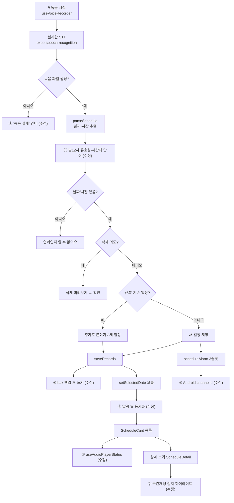

# 2026-10-09 코드 리뷰 수정 내역 · 실기기 확인 체크리스트

브랜치: `claude/awesome-pasteur-jgemfk` (main 미머지). 자동 테스트: `npm test` (jest-expo, 59개), `npm run typecheck`.

## 1. 수정 요약표

| # | 영역 | 증상 (수정 전) | 원인 | 수정 | 자동 테스트 | 실기기 확인 |
|---|------|----------------|------|------|------------|-------------|
| 1 | 카드 재생 (`components/ScheduleCard.tsx`) | 재생이 끝나도 ⏸ 아이콘이 그대로. 다시 누르면 "일시정지"로 처리돼 두 번 눌러야 재생 | `useAudioPlayer()`가 주는 player의 `currentTime`은 리렌더를 일으키지 않는 네이티브 getter라 `useEffect([player.currentTime])`이 안 돌았음 | `useAudioPlayerStatus(player)`로 반응형 상태 구독. 재생 시작 후 300ms는 이전 재생의 stale 상태 무시 | ScheduleCard.test 5개 | 필요 |
| 2 | 상세 구간재생 (`components/ScheduleDetail.tsx`) | 단어 탭하면 그 단어에서 안 멈추고 파일 끝까지 재생. 단어 하이라이트가 안 움직임 | 위와 동일 | 위와 동일 + 구간 끝 도달 시 pause | ScheduleDetail.test 4개 | 필요 |
| 3 | 파서 (`lib/parseSchedule.ts`) | "밤 12시"→정오 / "2월 30일"→3월 2일 / "13월 1일"→내년 1월 1일 / "25시"→새벽 1시 / "3일 후"에 말한 시각이 저장 / "19시 저녁 식사"→"식사", "열두시 정각 점심"→빈 내용 | 12시 예외 미처리, 월·일·시 범위 검사 없음, 시간대 단어를 무조건 삭제 | 밤 12시=24시(다음날 0시), 월·일·시 유효성 검사(2/29는 가장 가까운 윤년), N일 후는 자정 기준, 시간대 단어는 시각 **앞**에 올 때만 삭제 | parseSchedule.test 32개 | 선택 (STT 결과로 재확인) |
| 4 | 달력 (`components/Calendar.tsx`) | 7월을 보다가 녹음/저장하면 선택 날짜는 바뀌는데 달력은 7월에 머묾 | 달력 월 상태가 최초 1회만 초기화됨 | `selectedDate`가 다른 달로 바뀌면 달력도 그 달로 이동. 사용자가 직접 넘긴 달은 유지 | Calendar.test 4개 | 필요 |
| 5 | Android 알림 (`lib/notifications.ts`) | Android에서 커스텀 알람음·최대 중요도 미적용 (채널 미등록 → 기본 채널) | Android 8+는 소리/진동이 채널에 묶임 | 모드별 채널 3개(`alarm_both`/`alarm_sound`/`alarm_vibe`) 등록, 예약 시 `channelId` 지정. iOS no-op | notifications.test 8개 | Android 기기 있을 때만 |
| 6 | 저장 (`lib/storage.ts`) | records.json 쓰기 중 크래시 → 파싱 실패 → 빈 배열 → 전체 일정 유실 가능 | 통째 덮어쓰기 + 실패 시 `[]` 반환 | 쓰기 전 직전본을 `records.bak.json`으로 복사, 로드 실패 시 백업으로 복구 | storage.test 6개 | 선택 |
| 7 | 녹음 실패 (`App.tsx`) | 녹음 파일이 안 만들어지면 아무 안내 없이 종료 | `if (!uri) return;` | 알림 표시 | — | 선택 |
| 8 | 구조 (`App.tsx` → `components/ScheduleCard.tsx`) | 카드 컴포넌트가 App 안에 있어 테스트 불가 | — | 파일 분리 (동작 변경 없음) | 위 1번 | 1번과 함께 |

## 2. 음성 파이프라인 순서도 — 수정 지점 표시

## 3. 실기기 확인 체크리스트

시뮬레이터로 먼저, 실기기는 필요 시. 각 항목 결과를 ✅/❌로 기록.

| # | 시나리오 | 기대 결과 | 결과 |
|---|----------|-----------|------|
| 1-a | 녹음된 일정 카드 ▶ 탭 → 끝까지 듣기 | 재생이 끝나면 아이콘이 ▶로 돌아옴 | |
| 1-b | 끝난 직후 ▶ 다시 탭 | 처음부터 재생, 아이콘 ⏸ 유지 (즉시 ▶로 튀지 않음) | |
| 1-c | 재생 중 ⏸ → ▶ | 멈춘 지점부터 이어서 재생 | |
| 1-d | 카드 A 재생 중 카드 B ▶ | A가 멈추고 B만 재생 | |
| 2-a | 상세에서 단어 하나 탭 | 그 단어 구간만 재생되고 끝에서 멈춤 | |
| 2-b | 재생 중 단어 하이라이트 | 현재 단어가 빨간 배경으로 따라감 | |
| 2-c | 단어 길게 → 다른 단어 탭 | 두 단어 사이 범위 재생 후 정지 | |
| 2-d | 스피커 ↔ 수화기 전환 | 즉시 출력 경로가 바뀜 | |
| 3-a | "밤 12시에 알람" 녹음 | 다음날 오전 12:00 으로 인식 | |
| 3-b | "오늘 19시 저녁 식사" 녹음 | 내용이 "저녁 식사"로 남음 | |
| 3-c | "2월 30일 회의" 녹음 | "언제인지 알 수 없어요" 안내 | |
| 4-a | 달력에서 다음 달로 넘긴 뒤 녹음으로 일정 추가 | 저장 후 달력이 오늘 달로 돌아오고 오늘이 선택됨 | |
| 4-b | 편집기에서 다른 달 날짜로 저장 | 달력이 그 달로 이동 | |
| 4-c | 달력을 다음 달로 넘기고 가만히 1분 대기 | 시계가 갱신돼도 달력 월이 바뀌지 않음 | |
| 5 | (Android만) 알람 울림 | alarm_long.wav 소리, 진동 모드는 무음+진동 | |
| 6 | 일정 저장 후 앱 재시작 | 일정 유지. Files 앱 등으로 `mallo/records.bak.json` 존재 확인(선택) | |
| 7 | 마이크 권한 거부 상태에서 녹음 시도 | "권한 없음" 또는 "녹음 실패" 안내 | |
